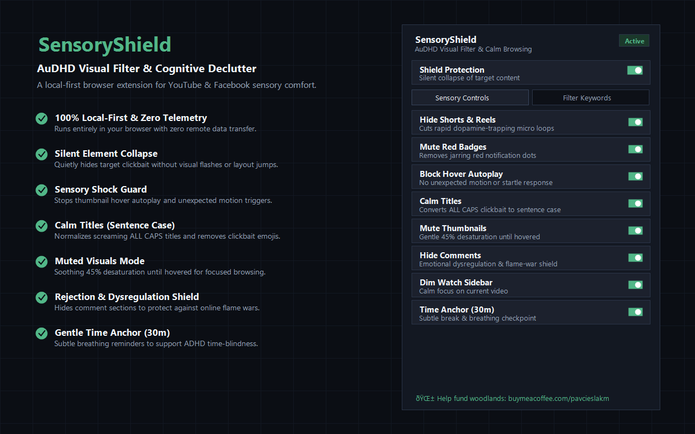

# SensoryShield — AuDHD Visual Filter & Declutter

SensoryShield is a Chrome extension (Manifest V3) that makes **YouTube** and **Facebook** calmer and more predictable. It is built for AuDHD and other neurodivergent users, and for anyone who finds busy feeds visually overwhelming: it quietly hides overstimulating clickbait, removes motion and urgency cues, and softens the interface.

**[Install from the Chrome Web Store](https://chromewebstore.google.com/detail/sensoryshield-audhd-visua/llcplpakmehklmdkgckokafjlgikmgbg)**



## Features

All features can be toggled in the popup.

- **Silent element collapse**: hides matching video cards, search results, recommendations and feed posts without flashing or layout jumps.
- **Keyword & creator filter**: a curated default list of common sexualised/clickbait terms, plus your own keywords, hashtags and channel names via a chip manager (reset to defaults any time).
- **Shorts & Reels blocker**: removes YouTube Shorts shelves and Facebook Reels.
- **Red badge silencer**: hides red notification badges and unread counters.
- **Hover autoplay guard**: stops thumbnail previews from auto-playing on hover.
- **Calm titles**: converts ALL-CAPS titles to sentence case and trims repeated exclamation marks.
- **Muted thumbnails**: optional desaturation of thumbnails until hovered.
- **Comments collapsed by default**.
- **Sidebar dimmer**: softly dims the recommendation rail on YouTube watch pages.
- **Gentle time anchor**: optional, subtle "take a breath" reminder every N minutes (default 30).
- **Low-stimulation UI**: dark sage palette, soft contrast, no animations.

## Privacy

- Runs entirely in your browser. No servers, no analytics, no tracking, no network requests.
- The only permission is `storage`; settings and keywords are saved in `chrome.storage.local` on your device.
- Content scripts run only on `youtube.com` and `facebook.com`.

See [PRIVACY_POLICY.md](PRIVACY_POLICY.md).

## Development install (load unpacked)

1. Clone this repository.
2. Open `chrome://extensions` (or `edge://extensions`, `brave://extensions`).
3. Turn on **Developer mode**.
4. Click **Load unpacked** and select the cloned folder.
5. Pin SensoryShield to the toolbar to open its settings.

## Project structure

```
manifest.json        Manifest V3 configuration
background.js        Service worker: default settings, local stats
content/
  shared.js          Filter engine, settings sync, MutationObserver
  youtube.js         YouTube card detection and filtering
  facebook.js        Facebook post detection and filtering
  styles.css         Declutter and silent-collapse styles
popup/               Settings popup (HTML, CSS, JS)
icons/               Extension icons
landing-page/        Static landing page
assets/              Store screenshot and generator script
```

## Contributing

Issues and pull requests are welcome, especially for:

- selectors that break after YouTube/Facebook layout changes,
- new low-stimulation options,
- accessibility improvements.

Please keep the project local-first: no tracking, telemetry or remote calls.

## License

[MIT](LICENSE) © 2026 Pawel Cieslak / Lucmedia
